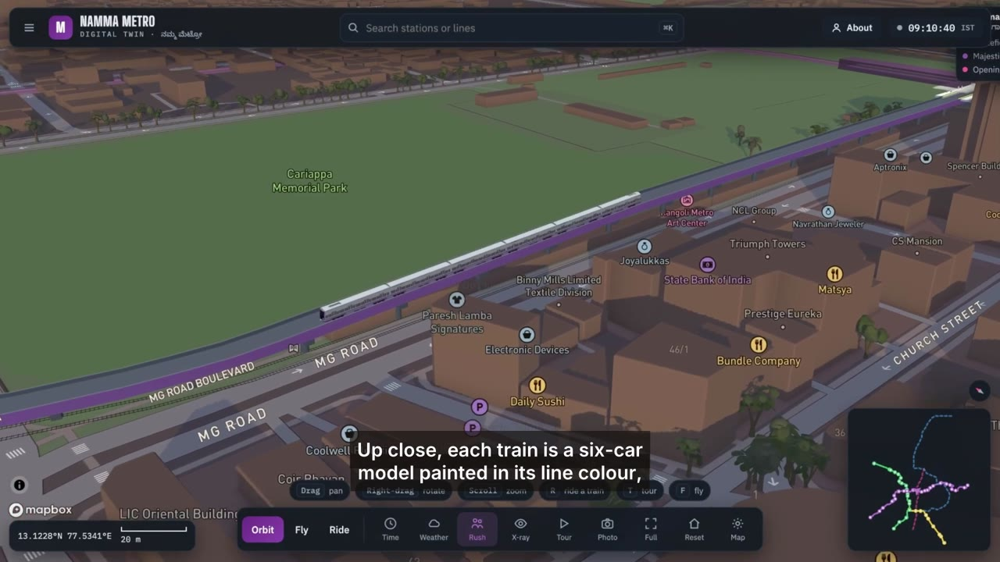

# Namma Metro Twin

**Live demo: [namma-metro-twin.netlify.app](https://namma-metro-twin.netlify.app)**

### Video walkthrough (2 min)

[](https://drive.google.com/drive/folders/14JRJC0wEEGxfiZCZx3o45lcoyua4WZqc?usp=drive_link)

**[▶ Watch the video on Google Drive](https://drive.google.com/drive/folders/14JRJC0wEEGxfiZCZx3o45lcoyua4WZqc?usp=drive_link)** (1080p, voice-over with subtitles). A copy is also in the repo: [`docs/demo.mp4`](docs/demo.mp4), captions in [`docs/demo.srt`](docs/demo.srt).

A 3D digital twin of Bengaluru's Namma Metro. Mapbox's 3D city is the base map; viaducts, tunnels, stations and 6-car trains are drawn on top with Three.js at exact coordinates. Trains run on BMRCL's published timetable pattern against the real clock (IST).

Features: live train positions from the timetable, station departures, journey planner, cab-view ride mode with next-station announcements, fly mode, cinematic tour, weather, X-ray (hide buildings to see tunnels), platform crowds, day/night lighting that follows the clock, minimap.

## Run locally

```bash
cp .env.example .env      # then put your Mapbox public token (pk.…) in .env
npm test                  # timetable engine checks
npm start                 # builds into dist/ and serves it
```

`.env` is git-ignored. The build script reads `MAPBOX_TOKEN` from `.env` locally, or from the environment in CI, and writes it into `dist/config.js`. The token is never committed.

## Deploy (Netlify, from GitHub)

Every push to `main` builds on Netlify with `npm test && npm run build` and publishes `dist/` (see `netlify.toml`).

Set `MAPBOX_TOKEN` in **Netlify → Project configuration → Environment variables**. A Mapbox `pk.` token is a public browser token by design, so it is visible in the shipped page; restrict it to your site's URL at account.mapbox.com/access-tokens so other sites can't use your quota. Never use an `sk.` secret token here; the build refuses one.

## Project layout

| Path | What it is |
| --- | --- |
| `src/index.html` | Page shell: top bar, side panel, cards, dock, popovers |
| `src/app.js` | Mapbox map, Three.js metro layer, modes (orbit, fly, ride, tour), UI logic |
| `src/engine.js` | Geometry, height profile, timetable, train physics, journey planner |
| `src/data.js` | Routes, stations, tunnel portals and the full timetable (built by `scripts/build_gtfs.py`) |
| `data/metro-lines-stations.geojson` | Source track and station data |
| `scripts/build_gtfs.py` | Builds `src/data.js` from the GTFS feed and future-line data |
| `data/bmrcl-gtfs.zip` | BMRCL GTFS feed (Vonter, ODbL) |
| `scripts/build.mjs` | Builds `dist/` and injects the token |
| `scripts/check.mjs` | Engine sanity tests |

## Data and accuracy

- **Timetable, track and stations (Purple, Green, Yellow):** the unofficial BMRCL GTFS feed by [Vonter/bmrcl-gtfs](https://github.com/Vonter/bmrcl-gtfs), transcribed from the timetables on bmrc.co.in, with track geometry and station positions from OpenStreetMap. Licensed ODbL 1.0 (`data/LICENSE-bmrcl-gtfs-ODbL.txt`); `src/data.js` is a derived database under the same licence. Rebuild with `python3 scripts/build_gtfs.py`.
- Every scheduled trip is included (Tue–Sat, Monday, Sunday and holiday timetables, holidays being the 2nd and 4th Saturdays), including BMRCL's short-loop trains.
- BMRCL publishes terminal times only. Intermediate station times are modelled from stop spacing, so they can differ from the platform display by a minute or two. There is no public live feed, so positions are simulated from the timetable, not tracked.
- Station names follow BMRCL's operational-lines map (version 05).
- **Future lines (Pink, Blue):** [geohacker/namma-metro](https://github.com/geohacker/namma-metro) (MIT), approximate.
- Base map © Mapbox © OpenStreetMap contributors.
